# Jonathan M.'s GitHub Profile

---

### About Me

- Actively developing Alaeh.PH, a web and mobile platform for local businesses related to real estate data.
- Learning data structures and algorithms in Python, with a focus on real estate data aggregation.
- Previously worked as a Technical Support Specialist at Jotform for 13 years, assisting users and troubleshooting technical issues.
- Aspiring Python developer focused on real estate data analysis and web development, pursuing a career shift toward technology and data-driven solutions.
- Enjoy watching podcasts, especially those related to AI and automation.
- Enjoy playing CRPGs and exploring modding communities in my free time.

---

### GitHub Stats

---

### Connect with Me

